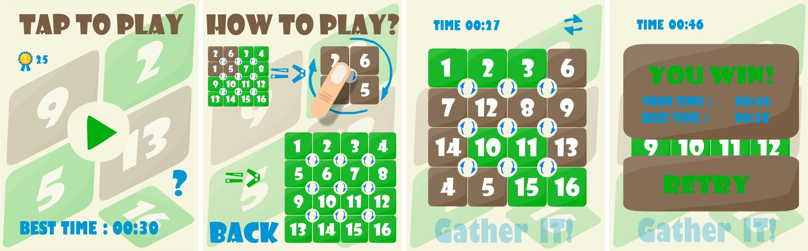
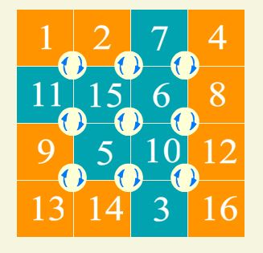

# Shishnashki

Logical puzzle game originally made in AS3.0, now also rewritten in JavaScript.

## Versions
- `game/src` — original ActionScript 3 source.
- `web` — JavaScript rewrite (HTML/CSS/JS).

## Run JavaScript version
Open `web/index.html` in a browser.

## Gameplay
Click one of the 3x3 overlay buttons to rotate the corresponding 2x2 block clockwise.
Arrange numbers from 1 to 16 in order.

### Screenshots from the original AS3 version

